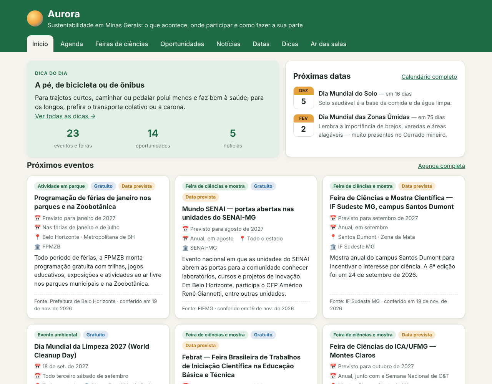
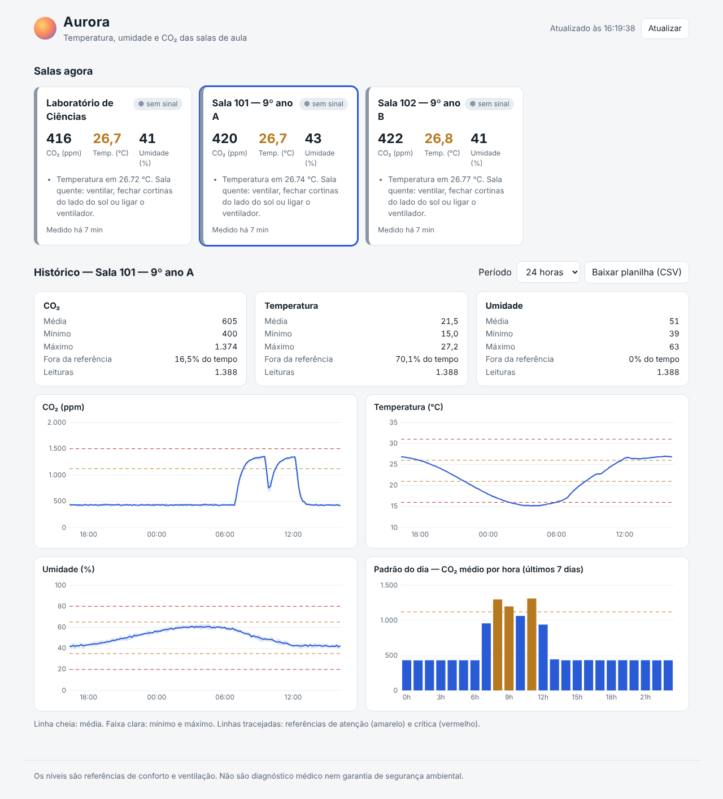

# Aurora

Base de sustentabilidade de Minas Gerais, feita por estudantes. Reúne num só lugar:

- **Agenda**: eventos ambientais, feiras sustentáveis e atividades em parques;
- **Feiras de ciências**: UFMG Jovem, Febrat, META/CEFET-MG, FEMIC, feiras dos IFs, SENAI, BH-TEC;
- **Oportunidades**: voluntariado, cursos gratuitos e vagas (com aviso de idade mínima);
- **Notícias** coletadas automaticamente de fontes confiáveis e **aprovadas pela equipe**;
- **Datas ambientais** do ano e **dicas** para ser mais sustentável;
- **Ar das salas** (módulo opcional): sensores de CO₂, temperatura e umidade nas salas de aula;
- **App**: instalável pelo navegador e também como APK para Android.

> **Importante.** A Aurora é um protótipo. Todo conteúdo tem link para a fonte original; confira
> datas e regras no site de quem organiza. Datas marcadas como *previsto* seguem o padrão dos anos
> anteriores e ainda não foram confirmadas. Os níveis de ar das salas são referências de conforto,
> **não** diagnóstico médico.



```
 fontes RSS ──coleta──▶ PENDENTE ──equipe aprova──▶ APROVADO ──▶ site público
 equipe ──cadastra──────────────────────────────────▶ APROVADO
 sensores das salas ──▶ leituras ──▶ painel "Ar das salas"
```

## O que tem aqui

| Pasta | O que é |
|---|---|
| `servidor/` | Site, API, banco de dados, coleta de notícias e comandos de terminal |
| `servidor/aurora/dados/semente.json` | Conteúdo inicial pesquisado (42 itens, 21 datas, 18 dicas, 3 fontes) |
| `android/` | App Android (o GitHub compila o APK sozinho) |
| `firmware/` | Programa do ESP32 do módulo de sensores |
| `firmware/teste_nativo/` | Testes do firmware que rodam no computador |
| `simulador/` | Finge ser um sensor, para testar sem hardware |
| `.github/workflows/` | Testes automáticos a cada envio para o GitHub |

## Começando

Precisa do Python 3.10 ou mais novo.

```bash
pip install -e "servidor[dev]"     # 1. instalar
aurora servir                      # 2. ligar (na primeira vez, carrega o conteúdo inicial sozinho)
```

Abra **http://127.0.0.1:8000**. Para outras pessoas da rede acessarem: `aurora servir --host 0.0.0.0`.

## Aurora como app

A Aurora pode ser usada de duas formas no celular:

### 1. App pelo navegador (Android, iPhone e computador)

O site já é um **app instalável**: tem ícone, abre em tela cheia e mostra sem internet o que já foi
visto (com o aviso "você está sem internet").

- **Android (Chrome):** abra o site e toque em **Instalar app** (ou menu ⋮ → *Instalar app*).
- **iPhone (Safari):** toque em **Compartilhar** → **Adicionar à Tela de Início**.
- **Computador (Chrome/Edge):** ícone de instalar na barra de endereço.

> O celular só oferece "Instalar" quando o site é aberto por **HTTPS** (endereço com cadeado).
> Na rede da escola, com `http://192.168…`, ele funciona como site normal — para esse caso, use o
> app Android abaixo, ou publique o servidor com HTTPS (veja "Colocando na internet").

### 2. App Android (APK)

A cada mudança na pasta `android/`, o GitHub compila o app sozinho e publica em **Releases**.
Link fixo para a versão mais nova:

**https://github.com/fernandofreitascruzdealmeidaal-glitch/aurora/releases/latest/download/aurora.apk**


Abra o arquivo no Android para instalar (pode ser preciso permitir *instalar apps desconhecidos*).
Na primeira vez, o app pede o **endereço do servidor** — o mesmo que aparece no computador onde a
Aurora está ligada, por exemplo `http://192.168.0.10:8000` (o celular precisa estar no mesmo Wi-Fi).
Para trocar depois: botão **Trocar o servidor do app**, no fim da página inicial.

Se um dia a Aurora tiver endereço fixo na internet, defina a variável `AURORA_SERVIDOR` em
*Settings → Secrets and variables → Actions → Variables* do GitHub: o app passa a abrir direto nele.

**Assinatura do app.** Por enquanto o APK é assinado com uma chave de desenvolvimento que está no
próprio repositório (`android/aurora-desenvolvimento.keystore`). Isso basta para testes, mas como o
repositório é público, qualquer pessoa poderia assinar um APK com ela. Antes de distribuir para
muita gente, crie uma chave própria e guarde nos segredos `AURORA_KEYSTORE_B64` e
`AURORA_KEYSTORE_SENHA` do GitHub — o workflow passa a usá-la sozinho.

### Colocando na internet (HTTPS)

Para o "Instalar app" aparecer em qualquer celular, fora da escola, o servidor precisa de um
endereço público com HTTPS. Opções comuns: um serviço de hospedagem de Python (como Render ou
Railway) ou um túnel (como Cloudflare Tunnel) a partir do computador da escola. Isso envolve conta
e configuração feitas por um adulto responsável; lembre-se de definir `AURORA_TOKEN_ADMIN`.

## Área da equipe (curadoria)

A área da equipe fica em **http://127.0.0.1:8000/equipe** e só funciona com um token secreto:

```bash
# Linux/Mac
export AURORA_TOKEN_ADMIN="invente-uma-frase-longa-e-secreta"
# Windows (PowerShell)
$env:AURORA_TOKEN_ADMIN = "invente-uma-frase-longa-e-secreta"
aurora servir
```

Lá a equipe pode:

- **aprovar ou rejeitar** notícias coletadas (ajustando tipo e região);
- **cadastrar** eventos, feiras, cursos e oportunidades (resumo com as próprias palavras + link oficial);
- **testar e cadastrar fontes RSS** e mandar **coletar agora**;
- despublicar ou excluir itens.

Nada coletado automaticamente aparece no site sem aprovação. Antes de aprovar, confira: o link
abre? É sobre sustentabilidade? A fonte é confiável? A região está certa?

### Coleta automática de notícias

```bash
aurora coletar                     # coleta uma vez (ex.: agendar no cron ou no Agendador de Tarefas)
AURORA_COLETA_MIN=120 aurora servir   # ou: coleta a cada 2 horas enquanto o servidor estiver ligado
```

Fontes iniciais: Agência Brasil e EcoDebate (ativas, filtradas por palavras de sustentabilidade) e
((o))eco (desativada até alguém clicar em **Testar** e confirmar o endereço). Para encontrar mais
fontes, procure no site da instituição o ícone de RSS ou um endereço terminado em `/feed`.

### Atualizando o conteúdo inicial

O arquivo `servidor/aurora/dados/semente.json` pode ser editado e recarregado com
`aurora importar-semente` — itens que já existem não são duplicados. Para o dia a dia, use a área
da equipe.

## Como a coleta se protege

| Situação | O que acontece |
|---|---|
| Fonte fora do ar ou com erro | O erro aparece na área da equipe; as outras fontes seguem normalmente |
| Fonte falha 10 vezes seguidas | É desativada sozinha, para não ficar tentando para sempre |
| A mesma notícia em duas fontes ou coletada de novo | Entra uma vez só (o link é normalizado, sem `utm_`) |
| Notícia sem relação com o tema | Ignorada pelo filtro de palavras-chave |
| Notícia muito antiga | Ignorada (mais de 45 dias) |
| Texto com HTML ou script | Vira texto puro antes de ser gravado; o site nunca interpreta HTML vindo de fora |
| Link `javascript:` ou estranho | Recusado |
| XML malicioso (ataques de entidade) | Recusado pela biblioteca `defusedxml` |
| Alguém cadastra uma "fonte" que aponta para a rede da escola | Bloqueado, inclusive via redirecionamento |
| Feed gigante | Cortado em 2 MB e 15 segundos |
| Sem token da equipe | Área da equipe desligada (403); token errado dá 401 |

---

# Módulo "Ar das salas" (sensores)

Mede temperatura, umidade e CO₂ em salas de aula. Um sensor em cada sala envia os dados pelo Wi-Fi
para o mesmo servidor, e a página **http://127.0.0.1:8000/salas** mostra a situação de cada sala,
o histórico e os padrões do dia.

```bash
aurora novo-dispositivo sala-101 "Sala 101 — 9º ano"    # cadastrar um sensor (guarde a CHAVE)
python simulador/simular.py --dispositivo sala-101 --chave COLE_A_CHAVE --historico 72
```



## Montando o sensor

| Peça | Observação |
|---|---|
| ESP32 DevKit (qualquer um com Wi-Fi 2,4 GHz) | o "cérebro" |
| Sensirion **SCD40** ou **SCD41** em placa breakout | mede CO₂ de verdade (NDIR), temperatura e umidade |
| 4 fios jumper + cabo USB | |

Ligações: `VIN/VCC → 3V3`, `GND → GND`, `SDA → GPIO 21`, `SCL → GPIO 22`.

Por que o SCD40/41 e não o MQ-135, que é mais barato? O MQ-135 não mede CO₂: ele reage a vários
gases e muda com a temperatura. Para dizer "abra a janela, o CO₂ está alto" com
honestidade, é preciso um sensor que meça CO₂ de fato.

Gravando o firmware (com [PlatformIO](https://platformio.org) instalado):

```bash
cd firmware
cp include/aurora_config.example.h include/aurora_config.h   # preencha Wi-Fi, endereço do servidor e chave
pio run -e esp32dev -t upload
pio device monitor                              # mostra o que o sensor está fazendo
```

Dica: comece com `AURORA_SIMULAR 1` no `aurora_config.h` para testar Wi-Fi e servidor antes de ligar o
sensor. Para os sensores alcançarem o computador, rode o servidor com
`aurora servir --host 0.0.0.0`.

## O que pode dar errado — e o que a Aurora faz

Nenhum sistema é infalível. O que dá para fazer é pensar antes no que pode falhar e garantir que,
quando falhar, nada se perca e alguém fique sabendo. Cada linha abaixo tem um teste automático
que comprova o comportamento.

| Situação | O que acontece |
|---|---|
| Wi-Fi cai (até 12 h) | O sensor guarda as leituras na memória e envia tudo quando a rede volta |
| Wi-Fi fora por mais de 12 h | Ficam as 720 leituras mais recentes; as mais antigas saem |
| Servidor desligado ou com erro | O sensor tenta de novo esperando 5 s, 10 s, 20 s… até 5 min, sem perder dados |
| A mesma leitura chega duas vezes | O servidor ignora a cópia (cada leitura tem um ID único) |
| Sensor com defeito manda 65535 ppm | Barrado no próprio ESP32, de novo no servidor e de novo no banco |
| Uma leitura ruim no meio de um lote | Só ela é recusada; as outras são guardadas |
| Lote que o servidor nunca aceitará | O sensor descarta, em vez de tentar para sempre |
| Chave errada | O sensor guarda os dados e tenta a cada 10 min (dá tempo de corrigir) |
| ESP32 sem saber a hora certa | Envia "medi há N segundos" e o servidor calcula a hora |
| Relógio do sensor adiantado | Leituras "do futuro" são recusadas com explicação |
| Programa do ESP32 trava | O watchdog reinicia o ESP32 em 60 s |
| Sensor para de responder | O firmware reinicia o sensor; se não voltar, reinicia o ESP32 |
| Contador de tempo do ESP32 dá a volta (a cada 49 dias) | Testado, nada quebra |
| Mais de 24 dias sem Wi-Fi (férias) | Testado: quando a rede volta, os envios recomeçam |
| Queda de energia no computador durante uma gravação | O banco usa transações e o modo WAL: grava tudo ou nada |
| Alguém tenta enviar dados falsos | Sem a chave do dispositivo, o servidor recusa (401) |
| Alguém copia o arquivo do banco | As chaves ficam guardadas só como hash; não dá para se passar por um sensor |
| Envio gigante ou malformado | Recusado antes de chegar ao banco (limite de 1 MB e de 500 leituras por envio) |
| Configuração errada no servidor | O servidor nem liga e explica o que está errado |
| Painel sem internet na escola | Funciona: não depende de nenhuma biblioteca de fora |

# Testes e configuração

## Testes

```bash
make verificar                 # tudo: estilo, testes do servidor e do firmware
cd servidor && pytest --cov    # só o servidor (exige pelo menos 90% de cobertura)
./firmware/teste_nativo/rodar.sh   # só o firmware (precisa de g++ e git)
```

O servidor tem 175 testes automáticos (98% do código coberto), incluindo ataques à coleta de notícias. Os testes do firmware rodam a lógica real do `main.cpp` no
computador, com Wi-Fi, HTTP e relógio de mentira, e com detectores de erros de memória ligados.
Ao subir o projeto para o GitHub, os testes rodam sozinhos e o firmware também é compilado para
o ESP32.

## Configuração do servidor

Por variáveis de ambiente (todas opcionais):

| Variável | Padrão | Para quê |
|---|---|---|
| `AURORA_BANCO` | `aurora.db` | Onde fica o arquivo do banco |
| `AURORA_TOKEN_PAINEL` | (vazio) | Se definido (mín. 12 caracteres), o painel das salas pede esse token |
| `AURORA_FUSO` | `America/Sao_Paulo` | Fuso usado nos padrões por hora e na planilha |
| `AURORA_INTERVALO_S` | `60` | Intervalo de envio dos sensores (define quando um sensor está "sem sinal") |
| `AURORA_TOKEN_ADMIN` | (vazio) | Liga a área da equipe (mín. 16 caracteres, diferente do token do painel) |
| `AURORA_COLETA_MIN` | `0` | Coleta automática de notícias a cada N minutos (15 a 1440; 0 = desligada) |

As faixas de referência ficam em `servidor/aurora/limites.py`. Os limites de **atenção** seguem
a ABNT NBR 17037, que desde 2024 substitui a antiga Resolução ANVISA RE nº 9/2003 (aquela do
"CO₂ até 1000 ppm"):

| Medição | Atenção fora de | Origem |
|---|---|---|
| CO₂ | mais de 700 ppm acima do ar externo (≈ 1120 ppm) | NBR 17037 |
| Temperatura | 21 a 26 °C | NBR 17037 |
| Umidade | 35 % a 65 % | NBR 17037 |

A norma é para ambientes **com ar-condicionado**; em salas sem climatização ela serve como
referência, não como obrigação. Os limites **críticos** (vermelho) são escolha do projeto. A
Aurora não mede o ar de fora: usa 420 ppm como valor típico (`CO2_EXTERNO_PPM`). Antes de
apresentar o projeto, confiram a norma com um professor ou mentor.

## Comandos de terminal

```bash
aurora novo-dispositivo sala-102 "Sala 102"   # cadastra e mostra a chave UMA vez
aurora dispositivos                           # lista e mostra quem está online
aurora trocar-chave sala-102                  # se a chave vazar
aurora remover-dispositivo sala-102 --sim     # apaga o sensor e as leituras dele
aurora limpar --dias 365                      # apaga leituras com mais de 1 ano
aurora importar-semente                       # (re)carrega o conteúdo inicial, sem duplicar
aurora coletar                                # busca notícias novas (ficam pendentes)
```

## Limitações conhecidas

- **Conteúdo envelhece.** Eventos anuais estão com data *prevista*; quando a organização divulgar
  a data oficial, atualizem na área da equipe e marquem "Data confirmada".
- **Idade mínima.** Algumas oportunidades (brigadas, vagas) são só para adultos — isso está escrito
  em cada item. Menores de 16 só podem trabalhar como jovem aprendiz (a partir dos 14).
- **Rede da escola.** Se a internet da escola usar proxy ou bloquear sites, a coleta mostra o erro
  na área da equipe; o resto do site funciona normalmente.
- **Sem criptografia na rede local.** Os sensores falam HTTP, não HTTPS. Na rede da escola isso
  é aceitável para um protótipo; para ir além dela, coloque o servidor atrás de HTTPS.
- **O buffer do sensor fica na RAM.** Se o ESP32 ficar sem energia, as leituras ainda não enviadas
  se perdem. Uma melhoria futura é guardá-las na memória flash.
- **Um só computador.** Se ele quebrar, o histórico vai junto. Façam cópia do arquivo `aurora.db`
  (por exemplo, toda semana para um pen drive ou para a nuvem).
- **O SCD4x precisa de ar fresco para se calibrar.** A calibração automática supõe que o sensor
  "veja" ar externo (~420 ppm) algumas vezes por semana. Uma sala sempre fechada pode ter leituras
  desviadas com o tempo.
- **O sensor esquenta um pouco.** A temperatura pode sair 1–3 °C acima da real, dependendo da
  caixa. Comparem com um termômetro e ajustem o offset do SCD4x se for preciso.

## Próximos passos sugeridos

1. Mostrar o site para colegas e professores: o que eles procurariam primeiro? O que falta?
2. Dividir a curadoria: cada integrante cuida de um tipo (feiras, voluntariado, notícias) e confere
   a área da equipe uma vez por semana.
3. Ligar para as instituições (BH-TEC, UFMG, IF) para confirmar as datas previstas de 2027.
4. Para o módulo de sensores: montar **um** sensor e deixar uma semana numa sala antes de expandir.
